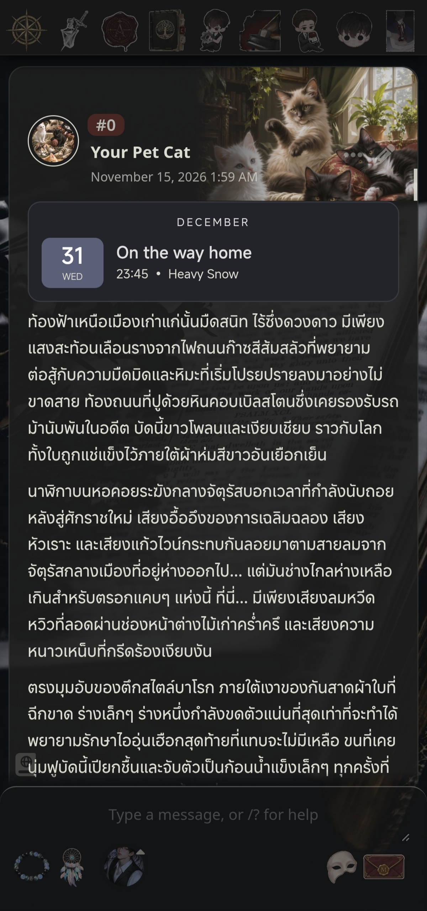
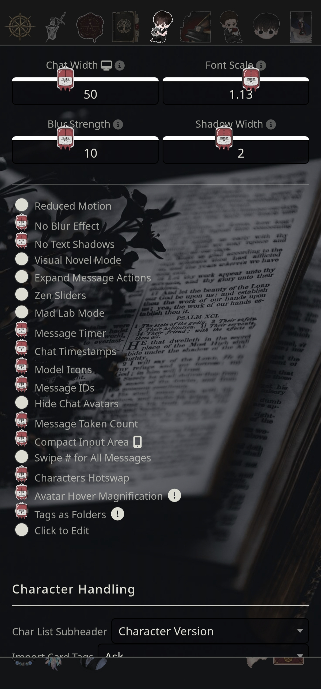
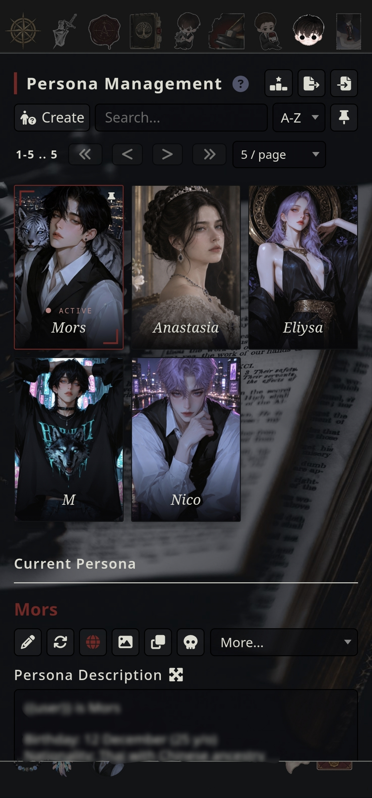
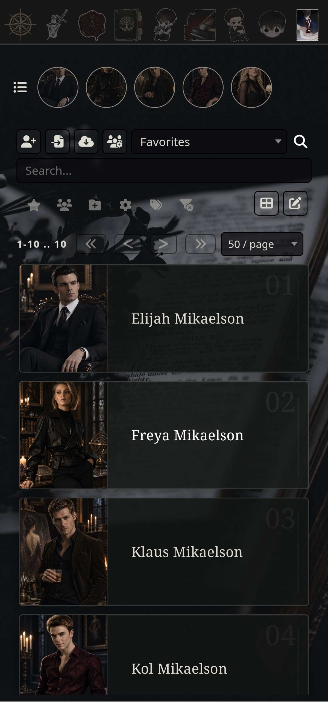
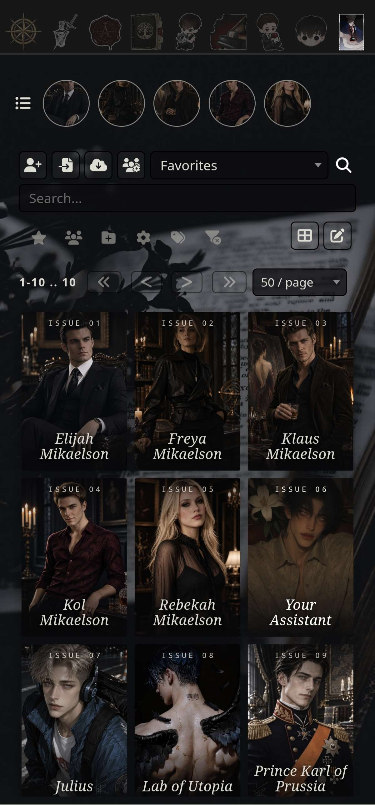

# Asphodel Reverie

A theme base for SillyTavern. It gives you the layout; your UI theme gives it the pictures.

## What it is

Asphodel Reverie is an extension that restyles SillyTavern: the chat, the character library, the persona page, the side panels, the top bar and the message box. One switch turns all of it on or off.

It is made to be a **base for many themes**. The layout work is already done, so making a new theme means choosing colours and pasting image links. You do not write selectors or layout CSS.

## What it is not

It is not a finished theme, and it does not include any pictures.

> **Every screenshot here shows the extension together with my own UI theme.**
> The picture icons, the panel background, and the slider and checkbox pictures come from that theme, not from the extension. Character and persona pictures come from the cards themselves.

Without a theme that sets pictures, you get the same layout with normal icons (in a colour you choose) and a plain panel background.

## Who provides what

| You see | It comes from |
| --- | --- |
| Picture icons in the top bar and around the message box | **Your UI theme** (Custom CSS) |
| Background picture of the side panels | **Your UI theme** (Custom CSS) |
| Picture on the slider handle and the ticked checkbox | **Your UI theme** (Custom CSS) |
| Logo on the welcome screen | **Your UI theme** (Custom CSS) |
| Text colours, chat tint, blur, fonts | **Your UI theme** (the normal ST theme settings) |
| Character and persona pictures | The cards and personas you have |
| Layout of every page, card designs, icon sizes and positions | **Asphodel Reverie** |
| Accent colours, top bar colour, icon colour, avatar settings | **Asphodel Reverie** (theme preset) |

## Screenshots

All taken on a phone, with my theme.

| Chat | Side panel |
| --- | --- |
|  |  |
| Whisper chat style. The top bar and message box icons are theme pictures. | The background, slider handles and ticked checkboxes are theme pictures. |

| Persona | Library: list | Library: grid |
| --- | --- | --- |
|  |  |  |
| Magazine covers, pinning, the active persona marked. | Wide cards with a large picture and a number. | Magazine covers, 2 to 6 columns. |

## Features

**Pages**

- **Chat** in Moonlit Echoes' Whisper style.
- **Character library** in two views: wide list cards, or a grid of magazine covers.
- **Persona page** as a grid of covers. The active persona is marked, and you can pin personas to the top.
- **Tidier toolbars**: buttons stay on one row and no longer wrap onto a line of their own.
- **Welcome screen** with a larger logo and without the shortcut buttons.
- **Preset panel tabs**: Parameters and Prompts on separate tabs (from Chat Completion Tabs, with its own on/off switch).

**For theme makers**

- **Picture slots**: 9 top bar icons, 5 message box icons, the panel background, the slider handle and the ticked checkbox. Each slot is one line in Custom CSS.
- **Nothing breaks when a slot is empty.** A button without a picture keeps its normal icon and takes the Icon Color from the settings.
- **Theme presets**: accent colours, background colours, top bar colour, icon colour, avatar width and position, avatar border. Presets can be saved, exported and imported.
- **Presets follow the UI theme**: a preset with the same name as a UI theme is loaded when you switch to that theme.
- **Notification styles**: choose a style for SillyTavern's pop-up notifications, or write, import and export your own CSS.

**On phones**

- Sliders move only when you drag the handle, and checkboxes toggle only when you tap the box. Scrolling past them no longer changes a setting by accident.
- The Custom CSS editor sits higher in User Settings, below Theme Colors.
- The Font Scale slider changes the chat text only. Interface text stays the same size.

## Install

### 1. Install the extension

1. In SillyTavern, open **Extensions** → **Install extension**.
2. Paste this address and confirm:
   ```
   https://github.com/Mors1212/Asphodel-Reverie
   ```

### 2. Set the thumbnail size

The library covers, the persona covers and the avatar behind each message are large. SillyTavern's default thumbnails are small, so they look blurry at that size. The values below are the recommended settings from the Moonlit Echoes Theme extension.

1. Open `config.yaml` in your SillyTavern folder and change the `thumbnails` part to:
   ```yaml
   thumbnails:
     enabled: true
     format: png
     quality: 100
     dimensions:
       bg:
         - 240
         - 135
       avatar:
         - 864
         - 1280
       persona:
         - 864
         - 1280
   ```
2. Delete the folder `data/default-user/thumbnails` inside your SillyTavern folder. SillyTavern makes it again by itself, with the new size.

**On Android (Termux)**

Termux's files are hidden from most file managers. This command, typed in Termux, opens the system Files app, which can reach them:

```
am start --user 0 -n com.google.android.documentsui/com.android.documentsui.files.FilesActivity
```

In the Files app, open the side menu and choose **Termux** at the very bottom, then go to the `SillyTavern` folder. From there you can open `config.yaml` with a text editor app (for example, txtpad).

To delete the thumbnails folder, type this in Termux (if SillyTavern is installed in `~/SillyTavern`):

```
rm -rf ~/SillyTavern/data/default-user/thumbnails
```

### 3. Restart SillyTavern

1. Restart SillyTavern, so the new thumbnail settings are used.
2. If you use **Moonlit Echoes Theme**, switch it off in its own settings. Asphodel Reverie already contains what it needs from it, and two copies of the same rules conflict.

## Make your own theme

1. **Import the template.** Download [`AR Template.json`](templates/AR%20Template.json), then in **User Settings** → **UI Theme** press the import button and choose the file.
2. **Paste your image links.** Open **Custom CSS** in User Settings. Every picture slot is listed there and set to `none`. Replace `none` with `url("your image link")`:
   ```css
   :root {
       --function-bg: url("https://example.com/background.jpg");
       --function-slider-icon: url("https://example.com/handle.png");
       --function-checkbox-icon: url("https://example.com/tick.png");
       --topbar-icon-settings: url("https://example.com/settings.png");
       --input-icon-send: url("https://example.com/send.png");
   }
   ```
   Fill in as many or as few as you like. Any slot left at `none` keeps its normal look.
3. **Save it under your own name** with the save-as button next to the UI Theme list. Set the colours in the Asphodel Reverie settings and save them as a preset **with the same name**; it will then load together with your theme.

To share a theme, give people two files: the UI theme `.json` and the exported preset (its file name starts with `[AR]`).

### Picture slots

| Variable | Where it shows |
| --- | --- |
| `--function-bg` | Background of the side panels and top bar drawers |
| `--function-slider-icon` | Slider handle.  |
| `--function-slider-track` | Colour of the slider track when the handle has a picture. Fill with a colour, not a picture |
| `--function-checkbox-icon` | Ticked checkbox  |
| `--topbar-icon-preset` | Top bar: AI Response Configuration |
| `--topbar-icon-api` | Top bar: API Connections |
| `--topbar-icon-formatting` | Top bar: Advanced Formatting |
| `--topbar-icon-worldinfo` | Top bar: Worlds / Lorebooks |
| `--topbar-icon-settings` | Top bar: User Settings |
| `--topbar-icon-backgrounds` | Top bar: Backgrounds |
| `--topbar-icon-extensions` | Top bar: Extensions |
| `--topbar-icon-persona` | Top bar: Persona Management |
| `--topbar-icon-characters` | Top bar: Characters |
| `--input-icon-options` | Message box: Options |
| `--input-icon-extensions` | Message box: Extensions |
| `--input-icon-impersonate` | Message box: Impersonate |
| `--input-icon-send` | Message box: Send |
| `--input-icon-stop` | Message box: Stop |

The welcome screen logo is set differently. In the template, find `.welcomeHeaderLogo` and replace `normal` with `url("your image link")`.

### Tips for pictures

- Use PNG or WebP with a transparent background for icons.
- Square pictures fit best. Tall or wide ones are shown whole and are not cropped.
- A slot left at none keeps the normal icon, but a link that no longer works leaves the button empty.

## Settings

Everything is in **Extensions** → **Asphodel Reverie**.

| Setting | What it does |
| --- | --- |
| Enable Asphodel Reverie | Turns the whole theme on or off |
| Preset tabs | Enable Parameters / Prompts tabs in the preset panel |
| Grid columns | 2 to 6 columns for the library and persona grids |
| Notifications | The style of pop-up notifications. "Basic" is the default; "None" is ST's own look |
| Theme preset | Save, load, import and export the values below |
| Avatar width, Position | How the avatar sits behind the message header |
| Hide avatar border | Removes the ring around avatars |
| Colours | Primary and secondary theme colour, main and secondary background colour, top bar colour, icon colour, chat background colour |

## Good to know

- The chat style is locked to Moonlit Echoes' Whisper while the extension is on.
- Visual Novel mode is not styled.

## Credits

- **[Moonlit Echoes Theme](https://github.com/RivelleDays/SillyTavern-MoonlitEchoesTheme)** by Rivelle: the base styling and the Whisper chat style.
- **[Chat Completion Tabs](https://github.com/RivelleDays/SillyTavern-ChatCompletionTabs)** by Rivelle: the preset panel tabs.

What was taken from each project and what was changed is listed in [THIRD-PARTY-NOTICES.md](THIRD-PARTY-NOTICES.md).

## Licence

Asphodel Reverie is released under the [GNU Affero General Public License v3.0](LICENSE), the same licence as the two projects it includes. If you share a changed version of the extension, it has to stay under AGPL-3.0 with its source code and the original notices.
